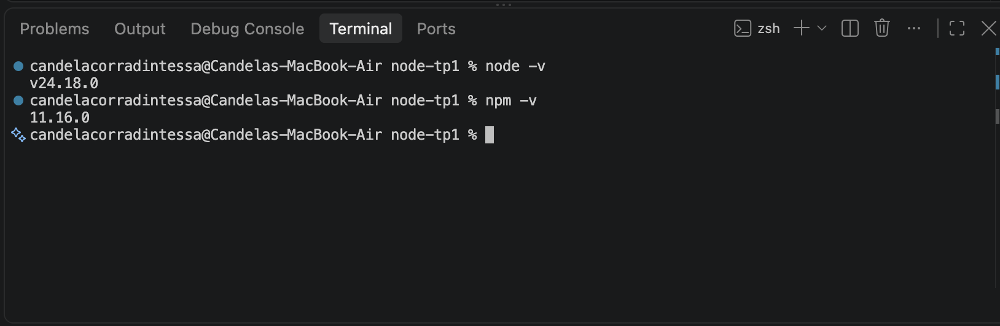
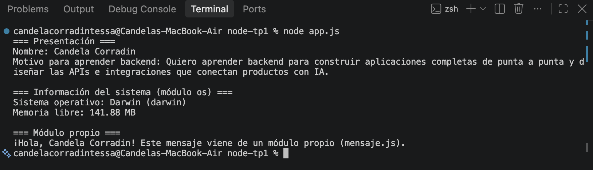

# Mi primer script en Node.js

Trabajo práctico de introducción a Node.js. El script `app.js` muestra un mensaje de presentación, usa el módulo nativo `os` para informar el sistema operativo y la memoria libre, e importa un módulo propio (`mensaje.js`) que exporta una función con un mensaje personalizado.

## Estructura

```
node-tp1/
├── app.js       # Script principal: presentación, módulo os y módulo propio
├── mensaje.js   # Módulo propio que exporta obtenerMensaje()
├── screenshots/ # Capturas de la instalación y la ejecución
└── README.md
```

## Requisitos

- Node.js y npm instalados. Verificar con:

```bash
node -v
npm -v
```



## Cómo clonar y ejecutar

```bash
git clone https://github.com/candelacorradin/node-tp1.git
cd node-tp1
node app.js
```

## Ejemplo de salida en consola

```
=== Presentación ===
Nombre: Candela Corradin
Motivo para aprender backend: Quiero aprender backend para construir aplicaciones completas de punta a punta y diseñar las APIs e integraciones que conectan productos con IA.

=== Información del sistema (módulo os) ===
Sistema operativo: Darwin (darwin)
Memoria libre: 141.88 MB

=== Módulo propio ===
¡Hola, Candela Corradin! Este mensaje viene de un módulo propio (mensaje.js).
```



> El sistema operativo y la memoria libre varían según el equipo donde se ejecute.

## Créditos

- **Autora:** Candela Corradin
- **Curso:** Diplomatura Full Stack — Centro de e-Learning UTN BA
- **Unidad:** Módulo 1 - Unidad 1: Mi primer script en Node.js
